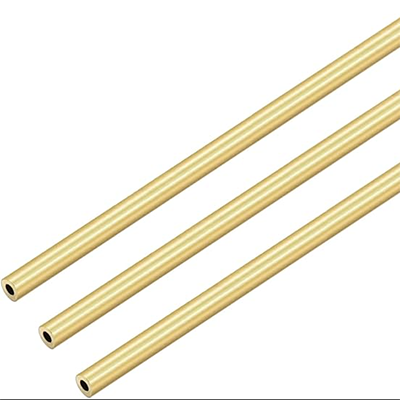

# Bill of Materials (BOM)

Printable parts link directly to their `.stl` file and PCBs to their production `.zip` (Gerber + drill files, ready to upload to a PCB manufacturer).

## Mechanics

| Name | Qty | Description | Comments | Suggested link | Image |
|------|-----|-------------|----------|----------------|-------|
| Steel ball | 12 | Ø1 mm (0.04") | Precision G10 or better. Can be sourced from small ball bearings | [Aliexpress](https://www.aliexpress.com/item/1005008399505167.html) | |
| PU stretch cord | 1 m | Ø1mm | e.g. "Stretch Magic" or "Magic String" | [Aliexpress](https://www.aliexpress.com/item/1005006140225266.html) |  |
| Neodym Cylinder Magnet | 70 | Ø3mm h=5 mm | N52 Grade | [NeoMagnets](https://www.buyneomagnets.com/p/3mm-dia-x-5mm-thick-n52-neodymium-rare-earth-disc-magnets-100-pack/) | |
| Brass Pipe | 1 m | OD=Ø2mm ID=Ø1 mm | | [Amazon](https://a.co/d/1pRFmtf), [Aliexpress](https://www.aliexpress.com/item/1005006371614363.html) |  |
| M2-8 dowel | 9 | | | [Aliexpress](https://www.aliexpress.com/item/1005009401701158.html) | |
| SHCS M2-8 | 9 | | | | |
| Set Screw M3-6 | 3 | | | | |
| FHCS M3-6 | 3 | | | | |
| FHCS M3-10 | 9 | | | | |
| FHCS M3-20 | 12 | | | | |
| Crimp Beads | 12 | | Used to affix the ends of the PU cord | | |

## Electronics

| Name | Qty | Description | Comments | Suggested link | Image |
|------|-----|-------------|----------|----------------|-------|
| DC-DC Step Down Module | 1 | 5V Fixed Output Step-Down Buck Converter | | [Aliexpress](https://www.aliexpress.com/item/1005008257960729.html) |  |
| (1N5819) OR (PMEG4010) | 1 | Diode (through-hole or SMD) | | | |
| Raspberry Pi Pico 2 | 1 | Microcontroller board | | [Aliexpress](https://www.aliexpress.com/item/1005007660023339.html) |  |
| MT6835 Magnetic Encoder Module | 3 | Magnetic encoder | | [Aliexpress](https://www.aliexpress.com/item/1005012795954973.html) |  |
| TB6612FNG Driver | 3 | | | [Aliexpress](https://www.aliexpress.com/item/1005006246388728.html) |  |
| 470 µF Electrolytic Capacitor | 3 | > 100 µF | anything > 100µF will work well | | |
| 10 µF Ceramic Capacitor 0603 | 3 | Optional | | | |
| 4.7 k Resistor 0603 | 2 | Optional | | | |
| NEMA 17 Stepper Motor | 3 | Body ≤ 38 mm | Body length <= 38mm | [Aliexpress](https://www.aliexpress.com/item/4001359634598.html) | |
| JST XH2.54 4P connector | 3 | 4P Housing & Header 2.54mm pitch | J1, J2, J3 (motors) | [Aliexpress](https://www.aliexpress.com/item/1005007080333485.html) |  |
| XT60H Connector | 1 | 2P Male & Female pair 7.5mm pitch | Power connector | [Aliexpress](https://www.aliexpress.com/item/1005007605928815.html) |  |
| PH2.0 4P Housing   PH2.0 8P Housing | 1   1 | 4P 2mm pitch Housing   8P 2mm pitch Housing | J5 (tool/I2C)  J4 (encoders) | [Aliexpress](https://www.aliexpress.com/item/1005010491403413.html) |  |
| PH2.0 4P Header   PH2.0 8P Header | 1   1 | 4P 2mm pitch Header   8P 2mm pitch Header | J5 (tool/I2C)   J4 (encoders) | [Aliexpress](https://www.aliexpress.com/item/1005010491403413.html) |  |

## PCBs

| Name | Qty | Description | Comments | File | Image |
| ---- | --- | ----------- | -------- | ---- | ----- |
| Control Board | 1 | | | [.zip](../../construction/v4_PCB_zip/PrecisionStepperController3X_v1.3.zip) |  |
| Ball Joint Plate (balljoint_plate_pcb) | 6 | | | [.zip](../../construction/v4_PCB_zip/balljoint_plate_pcb_jlcpcb.zip) |  |
| Encoder Board | 1 | | | [.zip](../../construction/v4_PCB_zip/EncoderBoard.zip) |  |

## 3D Printing

| Name | Qty | Description | Comments | File | Image |
| ---- | --- | ----------- | -------- | ---- | ----- |
| Motor Horn | 3 | | 0.4 mm+ nozzle may require post-processing | [.stl](../../construction/v4_3dprinting_stl/machine/MotorHorn.stl) |  |
| RubberBandCollet | 12 | | 0.4 mm nozzle, 0.1mm Layer height + may require post-processing | [.stl](../../construction/v4_3dprinting_stl/machine/RubberBandCollet.stl) |  |
| Motor Mount | 3 | | | [.stl](../../construction/v4_3dprinting_stl/machine/MotorMount.stl) |  |
| End Effector | 1 | | | [.stl](../../construction/v4_3dprinting_stl/machine/EndEffector.stl) |  |
| Base Block | 1 | | | [.stl](../../construction/v4_3dprinting_stl/machine/BaseBlock.stl) |  |

# Tool - Rod Sharpener

## 3D Printing

| Name | Qty | Description | Comments | File | Image |
| ---- | --- | ----------- | -------- | ---- | ----- |
| Rod Guide | 1 | | | [.stl](../../construction/v4_3dprinting_stl/tools/rod_sharpener/RodGuide.stl) |  |
| Blade Carrier | 1 | | | [.stl](../../construction/v4_3dprinting_stl/tools/rod_sharpener/BladeCarrier.stl) |  |

# Tool - Rod Length Setting Press

## PCBs

| Name | Qty | Description | Comments | File | Image |
| ---- | --- | ----------- | -------- | ---- | ----- |
| ball_alignment_disc_pcb | 1 | | | [.zip](../../construction/v4_PCB_zip/ball_alignment_disc_pcb.zip) |  |

## 3D Printing

| Name | Qty | Description | Comments | File | Image |
| ---- | --- | ----------- | -------- | ---- | ----- |
| RodGrindingJigA | 1 | | | [.stl](../../construction/v4_3dprinting_stl/tools/rod_length_setting_press/RodGrindingJigA.stl) |  |
| RodGrindingJigB | 1 | | | [.stl](../../construction/v4_3dprinting_stl/tools/rod_length_setting_press/RodGrindingJigB.stl) |  |
| RodGuide | 1 | | | [.stl](../../construction/v4_3dprinting_stl/tools/rod_length_setting_press/RodGuide.stl) |  |
| RodCollet | 2 | | | [.stl](../../construction/v4_3dprinting_stl/tools/rod_length_setting_press/RodCollet.stl) |  |
| CaliperClamp | 2 | | | [.stl](../../construction/v4_3dprinting_stl/tools/rod_length_setting_press/CaliperClamp.stl) |  |
